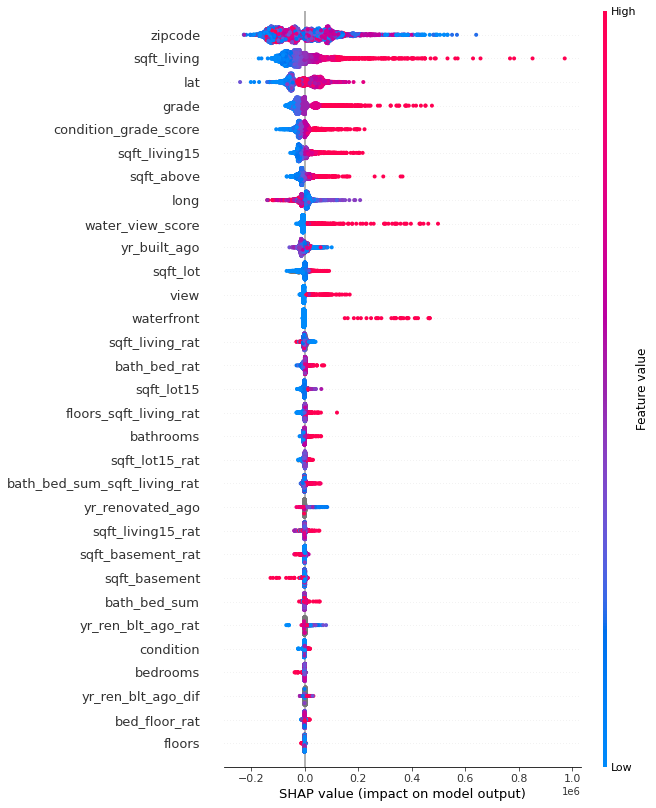

# 04 · Hedonic Housing Price Modeling with Variance-Weighted CV & SHAP Explainability

## Why I Built This (2022)
Standard regression notebooks often make three mistakes on real-estate data: they leak future information through random train/test splits, they encode raw calendar years (`yr_built`) that drift out of distribution over time, and they pick hyperparameters by raw validation score without penalizing train-vs-validation variance.

I built this pipeline to demonstrate a production-grade workflow on hedonic housing data:
1. **Physical-Constraint Anomaly Cleaning (`clean_anomalies`):**
   - Verified structural identities (`sqft_living == sqft_above + sqft_basement` and `yr_renovated >= yr_built`) and nullified physically impossible lot records where `sqft_living > sqft_lot`.
2. **Time-Invariant Feature Engineering (`engineer_features`):**
   - Converted raw calendar years (`yr_built`, `yr_renovated`) into capture-relative ages (`yr_built_ago`, `yr_renovated_ago`), age ratios, room/floor density ratios, and domain composite scores (`water_view_score = 5 * waterfront + view`, `condition_grade_score = 2 * condition + grade`).
3. **Chronological Out-of-Time Holdout & Custom Variance-Weighted Metric (`perfo_vw`):**
   - Reserved the final **20% chronological slice** (`testing == 1` sorted by `date`) strictly for out-of-time decay evaluation.
   - Evaluated hyperparameter candidates (`MSE` vs. `MAE` loss across tree complexities) using a custom variance-penalized score:
     ```text
     perfo_vw = 2 * R²_valid - R²_train = R²_valid - (R²_train - R²_valid)
     ```
   - Result: **`0.892` CV R² → `0.873` Out-of-Time Test R²** (only **`2.15%` out-of-time decay** and **`12.77%` MAPE**).
4. **Global & Local Explainability (`SHAP TreeExplainer`):**
   - Extracted exact tree splits (`output_48_0.svg`), individual record force attributions (`shap_force_single.html`), 1,000-home interactive force plots (`shap_force_multiple.html`), and global beeswarm feature impacts (`output_58_0.png`), uncovering non-linear latitude/longitude pricing gradients and strong lift from the engineered `condition_grade_score` and `water_view_score`.



---

## Files in This Folder
- [`housing_price_pipeline.py`](./housing_price_pipeline.py) — Standalone, 2026-refactored Python 3.12 / LightGBM 4.x / SHAP pipeline with a built-in `--demo` generator (`python housing_price_pipeline.py --demo`).
- [`index.html`](./index.html) — Full exported notebook with exploratory data analysis, anomaly plots, and SHAP commentary.
- [`shap_force_single.html`](./shap_force_single.html) & [`shap_force_multiple.html`](./shap_force_multiple.html) — Interactive SHAP force plots.
- [`output_58_0.png`](./output_58_0.png) & [`output_48_0.svg`](./output_48_0.svg) — Global SHAP beeswarm summary and Tree 0 decision graph.
